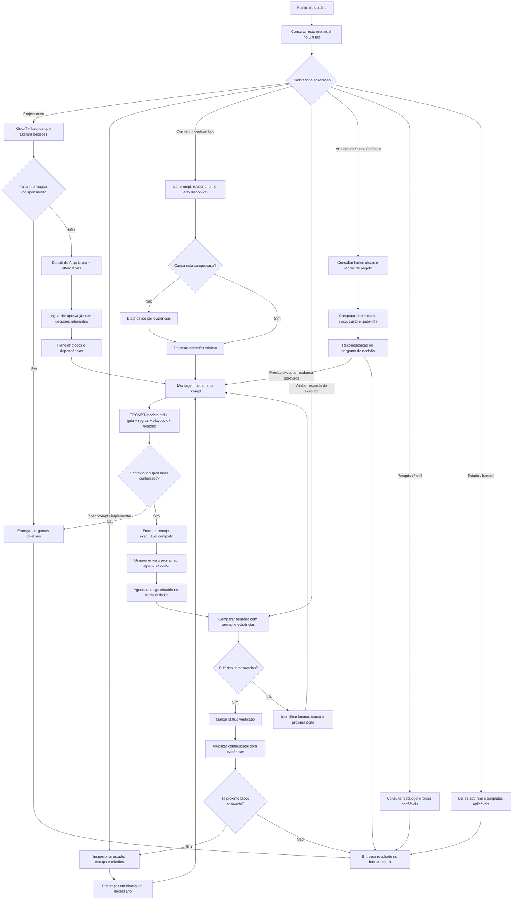

# Rota operacional — árvore de decisão do kit

**Este é o documento operacional dinâmico.** O bootstrap permanente `00_ROTA-DE-CONSULTA.md` aponta para esta rota. Atualize este arquivo quando mudar o processo; não peça ao usuário para substituir o bootstrap nas fontes do ChatGPT em mudanças normais do kit.

## 1. Entrada comum

Para solicitações que usam o kit:

1. Identifique o objetivo do usuário e classifique a solicitação.
2. Leia os arquivos de contexto específico do projeto que existam e sejam acessíveis.
3. Consulte apenas os documentos do kit pertinentes à ramificação; todos os arquivos lidos devem ser anotados no bloco `CONSULTA`.
4. Siga a ramificação abaixo. Se mais de uma se aplicar, combine-as, sem duplicar instruções.
5. Quando o objetivo for entregar um prompt para um agente executor, todas as ramificações que pedem criação, implementação ou correção convergem para a **montagem comum de prompt** na seção 3.
6. Entregue o resultado no formato definido pelo kit: perguntas objetivas, Dossiê de Arquitetura, prompt completo, validação com evidências, arquivo de estado completo ou handoff. Não apresente proposta como se já tivesse sido executada.

## 2. Árvore de decisão

## 3. Montagem comum do prompt

Esta etapa é obrigatória para prompts de implementação, correção e outras tarefas executáveis.

Leia:

1. `02_modelos/PROMPT-modelo.md` — estrutura obrigatória.
2. `02_modelos/guia-preenchimento-prompt.md` — preenchimento e checklist.
3. `02_modelos/regras-prompt.md` — precisão, autorização, proteção da codebase, testes, evidências e Quality Gate.
4. `01_instrucoes/playbook-orquestrador.md` — blocos, dependências, configuração e ciclo de validação.
5. `02_modelos/modelo-resposta-agente.md` — relatório obrigatório do executor.
6. `01_instrucoes/regras-projetos.md` — quando houver impacto em arquitetura, contratos, dados, segurança, desempenho ou manutenção.
7. A metodologia pertinente em `05_metodologias/`, quando aplicável.
8. Estado e decisões atuais do projeto, se a tarefa depender deles.

O prompt deve manter os títulos e campos definidos em `PROMPT-modelo.md`, preencher objetivo, contexto, alterações autorizadas/proibidas, restrições, critérios, saída e estado esperado. Use apenas modelos e ferramentas que o usuário informou possuir. Não suponha que o executor conseguirá acessar os links: inclua nele as instruções críticas.

**Saída desta etapa:**
- Se faltar dado indispensável: faça somente as perguntas necessárias para decidir com segurança.
- Se o contexto for suficiente: entregue um único prompt completo, pronto para copiar, seguindo o modelo do GitHub.
- Não apresente um prompt parcial como se estivesse pronto para execução.

## 4. Ramificações — documentos obrigatórios

| Tipo de solicitação | Documentos base | Saída esperada |
|---|---|---|
| Projeto novo | `02_modelos/kickoff-projeto.md`, playbook, regras de projeto | Perguntas estritamente necessárias; depois Dossiê de Arquitetura, alternativas e plano de blocos |
| Prompt para nova funcionalidade | Modelo de prompt, guia, regras de prompt, playbook, modelo de resposta; regras do projeto/metodologia conforme necessidade | Prompt completo ou perguntas indispensáveis |
| Correção de bug | Arquivos comuns de prompt, playbook, regras do projeto, `05_metodologias/diagnostico-bugs.md`; prompt/relatório/diff se fornecidos | Diagnóstico baseado em evidência; prompt de investigação ou correção, conforme a causa comprovada |
| Corrigir saída de outro agente | Prompt original, relatório do agente, diff/logs disponíveis, modelo de resposta, regras e playbook | Validação do que falhou e prompt de correção ligado ao objetivo original |
| Validar execução | Prompt original, `02_modelos/modelo-resposta-agente.md`, playbook, regras de prompt; metodologia de revisão quando houver diff | Status `CONCLUÍDO`, `PARCIAL`, `BLOQUEADO` ou `FALHOU`, evidências e próxima ação |
| Arquitetura / stack / tecnologia | Kickoff se aplicável, regras de projeto, playbook e documentação oficial atual | Alternativas comparadas, trade-offs, riscos e recomendação; decisão só após aprovação |
| Pesquisa de metodologia | `05_metodologias/README.md` e arquivo específico | Procedimento pertinente, limitações e critério de conclusão |
| Skill externa | `04_skills/skills-catalog.md` | Candidatas separadas de skills aprovadas; não afirmar aprovação sem cumprir o catálogo |
| Continuidade / handoff | Estado atual do projeto, `03_continuidade/handoff-novo-chat.md` e templates pertinentes | Arquivos completos atualizados e texto de abertura, sem depender da memória do chat |

## 5. Como ler o estado específico do projeto

A fonte canônica das regras globais é este repositório do kit. Para o estado específico de uma aplicação:

1. Consulte primeiro o repositório GitHub dessa aplicação, no caminho exato registrado no `project-index`.
2. Se o arquivo de estado não estiver versionado ali, consulte as fontes do projeto no ChatGPT onde o usuário o disponibilizou.
3. Se não houver estado real, use o template correspondente e identifique explicitamente que se trata de inicialização; não preencha resultados ou decisões desconhecidos.
4. Nunca use a Biblioteca do ChatGPT como fallback e nunca presuma estado de outro chat ou projeto.

Os nomes recomendados são `project-index.<projeto>.md`, `current-status.<projeto>.md` e `decisions.<projeto>.md`. O arquivo `decisions` guarda decisões aprovadas, não propostas.

## 6. Relatório, validação e ciclo de correção

Quando o usuário devolver a execução:

1. Leia o relatório, o prompt emitido e as evidências disponíveis.
2. Compare cada critério com a evidência, verifique o escopo autorizado, desvios, testes e estado esperado.
3. Marque `CONCLUÍDO` somente para critérios comprovados; use `PARCIAL`, `BLOQUEADO` ou `FALHOU` quando necessário e explique o motivo.
4. Se houver falha, diferencie causa confirmada de hipótese. Quando útil, use diagnóstico de bugs ou revisão de código.
5. Se a próxima ação exigir execução, volte à montagem comum do prompt e emita um prompt de correção delimitado.
6. Após concluir, entregue os arquivos de continuidade completos que mudaram. O usuário atualiza as fontes do projeto; não diga que o ChatGPT as substituiu automaticamente.

## 7. Consulta e bloqueios

Em respostas que usam esta rota, abra com:

| Arquivo (caminho) | Fonte | Identificador |
|---|---|---|

Registre somente os arquivos realmente consultados. Use caminho e commit/URL quando disponíveis; caso contrário, escreva `sem identificador`. Identifique arquivos não acessados e o motivo.

Se o GitHub estiver indisponível ou um arquivo essencial não puder ser lido, declare `BLOQUEADO` para a etapa dependente. Não troque silenciosamente para Biblioteca, arquivos antigos ou memória. Continue somente em tarefas independentes que não dependam do material ausente.
