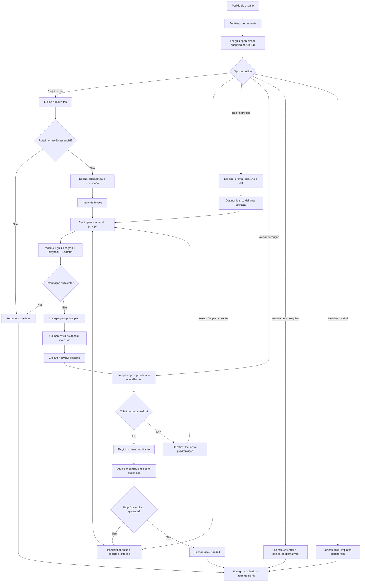

<div align="center">

# AI Research Knowledge Center

**Um sistema documental para orientar agentes de IA em engenharia de software.**

Regras claras · Prompts verificáveis · Execução por blocos · Evidências reais

[Começar](#comece-por-aqui) · [Como funciona](#como-o-sistema-funciona) · [Contribuir](#como-contribuir) · [Estrutura](#mapa-do-repositório) · [Benefícios](#por-que-usar)

</div>

---

## O que é

O **AI Research Knowledge Center** organiza os modelos, regras, procedimentos, metodologias e skills utilizados para orientar o ChatGPT e outros agentes durante trabalhos de engenharia de software.

Em vez de concentrar tudo em um prompt gigante, cada arquivo tem uma responsabilidade clara:

- **Modelos:** padronizam a estrutura de prompts, relatórios e kickoffs.
- **Regras:** estabelecem limites de escopo, qualidade e evidências.
- **Playbook:** coordena as etapas e o trabalho do orquestrador.
- **Metodologias:** descrevem práticas específicas, como TDD, diagnóstico de bugs e revisão de código.
- **Skills:** catalogam recursos externos com origem e versão identificáveis.
- **Continuidade:** preserva o estado e as decisões de cada projeto.

> O kit orienta o trabalho; não substitui as decisões aprovadas, a documentação oficial, os testes nem as evidências da execução.

## Comece por aqui

1. **Configure o ChatGPT:** siga [`00_GUIA-DE-CONFIGURACAO.md`](00_GUIA-DE-CONFIGURACAO.md).
2. **Adicione o bootstrap uma única vez:** disponibilize [`00_ROTA-DE-CONSULTA.md`](00_ROTA-DE-CONSULTA.md) nas fontes do projeto. Ele é estável e direciona para [`00_GUIA-DE-CONFIGURACAO.md`](00_GUIA-DE-CONFIGURACAO.md), o índice operacional canônico e mutável.
3. **Mantenha os arquivos de estado do projeto:** crie a partir dos templates em `03_continuidade/` os arquivos reais `project-index.<projeto>.md`, `current-status.<projeto>.md` e `decisions.<projeto>.md`. Esses arquivos pertencem ao projeto e não devem ser guardados como estado global do kit.
4. **Prepare o prompt:** leia o modelo, o guia de preenchimento, as regras, o playbook e, quando aplicável, as regras do projeto e a metodologia específica.
5. **Valide o resultado:** exija relatório no formato [`02_modelos/modelo-resposta-agente.md`](02_modelos/modelo-resposta-agente.md) e confira as evidências antes de avançar.

## Como usar comandos e informar contexto

Use o formato **`/comando [contexto]`**: escreva primeiro o comando e, depois, se necessário, acrescente o contexto. O contexto é opcional.

- **Somente o comando** — use quando a intenção já estiver clara ou o contexto relevante estiver estabelecido na conversa. O roteador consulta o guia operacional e recupera apenas as informações necessárias.
- **Comando + contexto** — use quando quiser indicar explicitamente o projeto, o objetivo, o sintoma, a restrição ou outra informação importante para a solicitação.
- **Contexto insuficiente ou ambíguo** — o roteador usa as informações disponíveis e faz uma pergunta objetiva somente quando faltar algo indispensável para seguir com segurança.

### Exemplos

```text
/continuidade
```

Inicia o fluxo de continuidade usando o contexto disponível na conversa e os arquivos de estado acessíveis.

```text
/continuidade SmartCart
```

Indica que a continuidade solicitada é para o projeto SmartCart.

```text
/prompt Criar uma skill para o Claude Code
```

Solicita a preparação de um prompt para criar uma skill destinada ao Claude Code.

```text
/bug O aplicativo falha ao salvar uma categoria. O erro aparece depois de clicar em Salvar.
```

Fornece o sintoma inicial para orientar o diagnóstico; não presume a causa do defeito.

### Regra de roteamento

O formato padrão é **`/comando [contexto]`**, não sendo necessário repetir informações que já estejam claras na conversa. O comando identifica o fluxo; o contexto restringe ou esclarece a tarefa. Se o contexto não for informado, o roteador não deve inventá-lo nem assumir dados ausentes: deve consultar as fontes pertinentes e perguntar apenas se a lacuna impedir a execução correta.

Os comandos listados no guia operacional são **aliases textuais**, não comandos nativos garantidos pela plataforma. Seu funcionamento depende de o chat ou agente ter recebido as instruções do kit. Uma menção como `@Continuidade` só deve ser tratada como chamada de skill/agente quando esse recurso estiver realmente disponível.

## Por que usar

| Risco comum | Como o kit ajuda |
|---|---|
| Requisitos ambíguos | Explicita objetivo, escopo, restrições e critérios de aceite |
| Prompts inconsistentes | Mantém um modelo fixo e um guia de preenchimento |
| Alterações não autorizadas | Separa mudanças permitidas das proibidas |
| Implementação grande demais | Divide o trabalho em blocos com dependências claras |
| Sucesso declarado sem prova | Exige testes e evidências reais por critério |
| Código difícil de manter | Considera arquitetura, extensibilidade, desempenho e complexidade proporcional |
| Perda de contexto | Usa arquivos de estado e handoff entre chats |
| Regras contraditórias | Define documentos canônicos e responsabilidades explícitas |

## Como o sistema funciona

O bootstrap fica nas fontes do projeto ChatGPT. Em cada solicitação relevante, o chat consulta `00_GUIA-DE-CONFIGURACAO.md`, identifica a intenção e segue somente o fluxo e as dependências obrigatórias. `01_instrucoes/rota-operacional.md` é uma ponte estável para o mesmo guia. Os documentos globais continuam no GitHub e não são copiados para o projeto.



### O ciclo em linguagem direta

1. **Consultar:** ler o índice `00_GUIA-DE-CONFIGURACAO.md` e somente os arquivos exigidos pelo fluxo selecionado. Registrar as fontes realmente lidas na tabela `CONSULTA`.
2. **Entender:** recuperar o estado e as decisões específicas do projeto; distinguir fatos, hipóteses e lacunas.
3. **Escolher o caminho:** projeto novo, prompt/implementação, bug/correção, validação, pesquisa/arquitetura ou continuidade.
4. **Preparar:** quando houver tarefa executável, todos os caminhos convergem para `02_modelos/PROMPT-modelo.md`, combinado com o guia, regras, playbook e relatório padronizado.
5. **Perguntar ou entregar:** se faltar um dado indispensável, fazer perguntas objetivas. Caso contrário, entregar um prompt completo, com alterações autorizadas, restrições, critérios de aceite, testes e estado esperado.
6. **Executar:** o usuário envia o prompt ao agente executor e devolve o relatório produzido por ele.
7. **Validar:** comparar os critérios com evidências reais e marcar `CONCLUÍDO`, `PARCIAL`, `BLOQUEADO` ou `FALHOU`.
8. **Repetir ou encerrar:** se algo falhou, investigar a causa e preparar um prompt de correção; se passou, atualizar os arquivos de continuidade e liberar o próximo bloco aprovado.

**Importante:** o kit orquestra e valida; não executa sozinho as alterações de código. O agente executor é quem realiza o trabalho concreto.
  
## Como os arquivos se relacionam

O fluxo detalhado e o infográfico resumido têm animações progressivas no README. Em ambos, uma esfera luminosa percorre cabos de fibra óptica, destaca a etapa ao chegar e segue as conexões conforme a lógica do diagrama. As rotas alternativas são mostradas uma por vez; o retorno de correção também é representado. Fundo, contraste e brilho adaptam-se aos temas claro e escuro. A animação é ilustrativa e não representa uma execução em tempo real. Os dois diagramas originais permanecem preservados. Para entender as ramificações conforme o tipo de pedido, veja também a árvore abaixo.

### Fluxo detalhado — dependências e retorno

<p align="center">
  <a href="assets/fluxo-orquestracao-animado.svg">
    
  </a>
</p>

<p align="center">
  <a href="assets/fluxo-orquestracao.svg">Ver versão estática adaptativa (SVG)</a> ·
  <a href="assets/relacionamento-arquivos.svg">Ver diagrama original (SVG)</a>
</p>

### Infográfico — visão resumida

<p align="center">
  <a href="assets/fluxo-orquestracao-infografico-animado.svg">
    
  </a>
</p>

<p align="center">
  <a href="assets/fluxo-orquestracao-infografico.svg">Ver infográfico estático adaptativo (SVG)</a> ·
  <a href="assets/relacionamento-arquivos-infografico.svg">Ver infográfico original (SVG)</a>
</p>

### Responsabilidade de cada camada

| Camada | Arquivo | Responsabilidade |
|---|---|---|
| Índice operacional | [`00_GUIA-DE-CONFIGURACAO.md`](00_GUIA-DE-CONFIGURACAO.md) | Fonte canônica mutável do roteamento, aliases, fluxos e caminhos de consulta |
| Bootstrap estável | [`00_ROTA-DE-CONSULTA.md`](00_ROTA-DE-CONSULTA.md) | Ponto de entrada permanente nas fontes do projeto; aponta para o índice operacional |
| Ponte estável | [`01_instrucoes/rota-operacional.md`](01_instrucoes/rota-operacional.md) | Direciona para o índice; não duplica regras operacionais |
| Modelo | [`02_modelos/PROMPT-modelo.md`](02_modelos/PROMPT-modelo.md) | Define os títulos e a estrutura do prompt |
| Preenchimento | [`02_modelos/guia-preenchimento-prompt.md`](02_modelos/guia-preenchimento-prompt.md) | Explica como preencher os campos |
| Regras de prompt | [`02_modelos/regras-prompt.md`](02_modelos/regras-prompt.md) | Define grounding, escopo, Quality Gate, testes e evidências |
| Orquestração | [`01_instrucoes/playbook-orquestrador.md`](01_instrucoes/playbook-orquestrador.md) | Coordena planejamento, blocos, validação e handoff |
| Regras do projeto | [`01_instrucoes/regras-projetos.md`](01_instrucoes/regras-projetos.md) | Orienta arquitetura, contratos e evolução do projeto |
| Metodologias | [`05_metodologias/`](05_metodologias/) | Apresenta procedimentos especializados aplicáveis por necessidade |
| Relatório | [`02_modelos/modelo-resposta-agente.md`](02_modelos/modelo-resposta-agente.md) | Registra alterações, testes, evidências, desvios e estado final |
| Continuidade | [`03_continuidade/`](03_continuidade/) | Fornece templates de estado e handoff |

**Regra de composição:** metodologia complementa as regras permanentes; não as substitui. O prompt final precisa conter as instruções críticas para o executor e não pode depender exclusivamente de links que talvez ele não consiga acessar.

## Mapa do repositório

```text
.
├── README.md
├── CONTRIBUTING.md
├── .github/
│   └── ISSUE_TEMPLATE/
│       ├── bug_report.yml
│       └── feature_request.yml
├── 00_ROTA-DE-CONSULTA.md
├── 00_GUIA-DE-CONFIGURACAO.md
├── 01_instrucoes/
│   ├── instrucao-projeto.md
│   ├── rota-operacional.md
│   ├── playbook-orquestrador.md
│   └── regras-projetos.md
├── 02_modelos/
│   ├── PROMPT-modelo.md
│   ├── guia-preenchimento-prompt.md
│   ├── regras-prompt.md
│   ├── modelo-resposta-agente.md
│   └── kickoff-projeto.md
├── 03_continuidade/
│   ├── handoff-novo-chat.md
│   └── *.template.md
├── 04_skills/
│   └── skills-catalog.md
├── 05_metodologias/
│   ├── README.md
│   ├── decomposicao-tarefas.md
│   ├── tdd.md
│   ├── diagnostico-bugs.md
│   └── revisao-codigo.md
├── assets/
│   ├── relacionamento-arquivos-infografico.svg
│   ├── relacionamento-arquivos.svg
└── kit-operacional.md
```

## Princípios de engenharia

- **Clarificar antes de construir:** compreender objetivo, escopo, limitações e critérios.
- **Dividir para validar:** declarar dependências e validar cada bloco antes do próximo.
- **Preservar o que funciona:** não expandir escopo silenciosamente nem alterar áreas não autorizadas.
- **Usar fontes confiáveis:** preferir documentação oficial atual para versões, APIs e comportamentos mutáveis.
- **Testar proporcionalmente ao risco:** relatar separadamente testes executados, não executados e bloqueados.
- **Não inventar evidências:** resultados só são declarados quando realmente observados.
- **Aplicar o Quality Gate:** avaliar manutenibilidade, arquitetura, extensibilidade, desempenho e se a complexidade introduzida é proporcional ao benefício.
- **Diferenciar propostas de decisões:** somente decisões aprovadas entram no registro canônico.

## Execução por blocos e Quality Gate

Cada bloco deve conter objetivo verificável, escopo autorizado, dependências, critérios de aceite, testes/evidências e condição de interrupção. Tarefas que afetam dados, autenticação, migrações, contratos públicos ou produção exigem análise e validação proporcionalmente mais rigorosas.

O Quality Gate não exige refatorar tudo: avalia apenas os critérios pertinentes ao escopo e ao risco. Uma alteração deve gerar benefício que justifique a complexidade e o custo introduzidos.

## Skills e metodologias

- Use [`04_skills/skills-catalog.md`](04_skills/skills-catalog.md) para skills externas aprovadas e com referência fixada.
- Use [`05_metodologias/README.md`](05_metodologias/README.md) para escolher o procedimento adequado ao problema.
- Não aplique todas as metodologias por padrão nem declare uma metodologia executada sem registrar as etapas e evidências correspondentes.

## Como contribuir

Use [`CONTRIBUTING.md`](CONTRIBUTING.md) como guia de contribuição.

- **Bugs e defeitos documentais:** abra uma GitHub Issue usando o formulário *Reportar bug*.
- **Melhorias e novas capacidades:** abra uma Issue usando o formulário *Propor melhoria*.
- **Alterações propostas:** use branch e Pull Request para revisão; relacione a Issue quando houver.
- **Histórico:** commits e Pull Requests registram o que foi alterado; Issues acompanham o problema, a discussão e o estado até a resolução.

Não mantemos um `BUGS.md` ou `MELHORIAS.md` como backlog paralelo. Isso duplicaria o rastreamento do GitHub e tenderia a ficar desatualizado. O guia de contribuição também define as regras para preservar o bootstrap permanente, atualizar documentos dependentes e regenerar `kit-operacional.md`.

## Manutenção e versionamento

- Este repositório é a fonte canônica das regras e modelos do kit; o estado de cada projeto fica nas fontes daquele projeto.
- Os documentos globais do kit são consultados exclusivamente no GitHub. Se ele estiver indisponível, declare bloqueio em vez de usar cópias antigas.
- Ao alterar regras, modelos ou metodologias, atualize as referências relacionadas e regenere `kit-operacional.md` para mantê-lo alinhado.
- `00_ROTA-DE-CONSULTA.md` e `01_instrucoes/rota-operacional.md` são arquivos estáveis: não devem ser alterados em mudanças comuns do kit. O roteamento e os fluxos são mantidos em `00_GUIA-DE-CONFIGURACAO.md` e nos documentos especializados indicados por ele.
- Uma mudança na branch de trabalho não é publicada automaticamente para os projetos: revise o diff e incorpore a proposta na branch principal somente após aprovação.
- Nunca armazene senhas, tokens ou credenciais.

## Referências e inspirações

- [Matt Pocock — Skills for Real Engineers](https://github.com/mattpocock/skills): práticas pequenas e combináveis para clarificação de requisitos, loops de feedback, TDD, diagnóstico e revisão de arquitetura. O kit adapta esses princípios sem importar automaticamente skills ou fluxos externos.
- [Documentação oficial do GitHub](https://docs.github.com/): referência para o comportamento da plataforma.
- Documentação oficial da linguagem, framework ou serviço do projeto: referência prioritária para APIs, versões e comportamento técnico mutável.

<div align="center">

**Menos suposições. Blocos menores. Feedback real. Mudanças auditáveis.**

</div>
