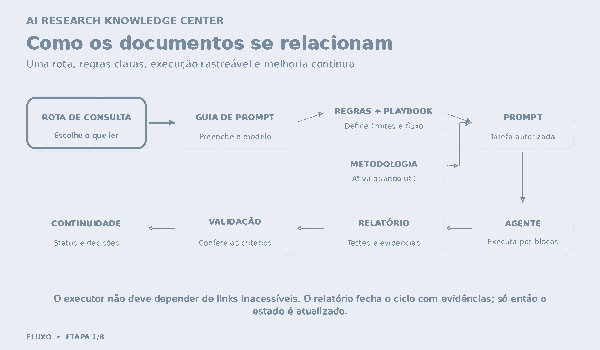
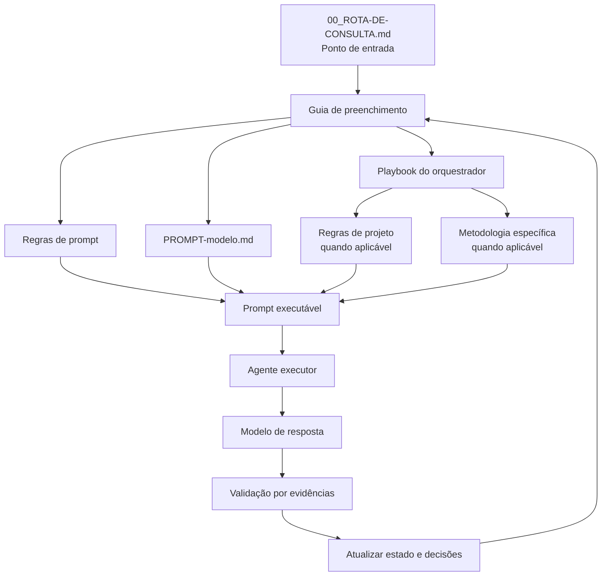

<div align="center">

# AI Research Knowledge Center

**Um sistema documental para orientar agentes de IA em engenharia de software.**

Regras claras · Prompts verificáveis · Execução por blocos · Evidências reais

[Começar](#comece-por-aqui) · [Fluxo](#como-os-arquivos-se-relacionam) · [Estrutura](#mapa-do-repositório) · [Benefícios](#por-que-usar)

</div>

---

## O que é

O **AI Research Knowledge Center** organiza os modelos, regras, procedimentos, metodologias e skills utilizados para orientar o ChatGPT e outros agentes durante trabalhos de engenharia de software.

Em vez de concentrar tudo em um prompt gigante, cada arquivo tem uma responsabilidade clara:

- **Modelos:** padronizam a estrutura de prompts, relatórios e kickoffs.
- **Regras:** estabelecem limites de escopo, qualidade e evidências.
- **Playbook:** coordena as etapas e o trabalho do orquestrador.
- **Metodologias:** descrevem práticas específicas, como TDD, diagnóstico de bugs e revisão de código.
- **Skills:** catalogam recursos externos com origem e versão identificáveis.
- **Continuidade:** preserva o estado e as decisões de cada projeto.

> O kit orienta o trabalho; não substitui as decisões aprovadas, a documentação oficial, os testes nem as evidências da execução.

## Comece por aqui

1. **Configure o ChatGPT:** siga [`00_GUIA-DE-CONFIGURACAO.md`](00_GUIA-DE-CONFIGURACAO.md).
2. **Adicione a rota ao projeto:** disponibilize [`00_ROTA-DE-CONSULTA.md`](00_ROTA-DE-CONSULTA.md) nas fontes do projeto. Ela é o ponto de entrada para selecionar os arquivos certos para cada tarefa.
3. **Mantenha os arquivos de estado do projeto:** crie a partir dos templates em `03_continuidade/` os arquivos reais `project-index.<projeto>.md`, `current-status.<projeto>.md` e `decisions.<projeto>.md`. Esses arquivos pertencem ao projeto e não devem ser guardados como estado global do kit.
4. **Prepare o prompt:** leia o modelo, o guia de preenchimento, as regras, o playbook e, quando aplicável, as regras do projeto e a metodologia específica.
5. **Valide o resultado:** exija relatório no formato [`02_modelos/modelo-resposta-agente.md`](02_modelos/modelo-resposta-agente.md) e confira as evidências antes de avançar.

## Por que usar

| Risco comum | Como o kit ajuda |
|---|---|
| Requisitos ambíguos | Explicita objetivo, escopo, restrições e critérios de aceite |
| Prompts inconsistentes | Mantém um modelo fixo e um guia de preenchimento |
| Alterações não autorizadas | Separa mudanças permitidas das proibidas |
| Implementação grande demais | Divide o trabalho em blocos com dependências claras |
| Sucesso declarado sem prova | Exige testes e evidências reais por critério |
| Código difícil de manter | Considera arquitetura, extensibilidade, desempenho e complexidade proporcional |
| Perda de contexto | Usa arquivos de estado e handoff entre chats |
| Regras contraditórias | Define documentos canônicos e responsabilidades explícitas |

## Como os arquivos se relacionam

O fluxo começa pela rota, que aponta para os documentos necessários à tarefa. Esses documentos alimentam o prompt; depois da execução, o relatório permite validar os resultados e atualizar a continuidade.

<p align="center">
  
</p>



### Responsabilidade de cada camada

| Camada | Arquivo | Responsabilidade |
|---|---|---|
| Entrada | [`00_ROTA-DE-CONSULTA.md`](00_ROTA-DE-CONSULTA.md) | Informa o que consultar por situação e como registrar fontes |
| Modelo | [`02_modelos/PROMPT-modelo.md`](02_modelos/PROMPT-modelo.md) | Define os títulos e a estrutura do prompt |
| Preenchimento | [`02_modelos/guia-preenchimento-prompt.md`](02_modelos/guia-preenchimento-prompt.md) | Explica como preencher os campos |
| Regras de prompt | [`02_modelos/regras-prompt.md`](02_modelos/regras-prompt.md) | Define grounding, escopo, Quality Gate, testes e evidências |
| Orquestração | [`01_instrucoes/playbook-orquestrador.md`](01_instrucoes/playbook-orquestrador.md) | Coordena planejamento, blocos, validação e handoff |
| Regras do projeto | [`01_instrucoes/regras-projetos.md`](01_instrucoes/regras-projetos.md) | Orienta arquitetura, contratos e evolução do projeto |
| Metodologias | [`05_metodologias/`](05_metodologias/) | Apresenta procedimentos especializados aplicáveis por necessidade |
| Relatório | [`02_modelos/modelo-resposta-agente.md`](02_modelos/modelo-resposta-agente.md) | Registra alterações, testes, evidências, desvios e estado final |
| Continuidade | [`03_continuidade/`](03_continuidade/) | Fornece templates de estado e handoff |

**Regra de composição:** metodologia complementa as regras permanentes; não as substitui. O prompt final precisa conter as instruções críticas para o executor e não pode depender exclusivamente de links que talvez ele não consiga acessar.

## Mapa do repositório

```text
.
├── README.md
├── 00_ROTA-DE-CONSULTA.md
├── 00_GUIA-DE-CONFIGURACAO.md
├── 01_instrucoes/
│   ├── instrucao-projeto.md
│   ├── playbook-orquestrador.md
│   └── regras-projetos.md
├── 02_modelos/
│   ├── PROMPT-modelo.md
│   ├── guia-preenchimento-prompt.md
│   ├── regras-prompt.md
│   ├── modelo-resposta-agente.md
│   └── kickoff-projeto.md
├── 03_continuidade/
│   ├── handoff-novo-chat.md
│   └── *.template.md
├── 04_skills/
│   └── skills-catalog.md
├── 05_metodologias/
│   ├── README.md
│   ├── decomposicao-tarefas.md
│   ├── tdd.md
│   ├── diagnostico-bugs.md
│   └── revisao-codigo.md
├── assets/
│   └── relacionamento-arquivos.gif
└── kit-operacional.md
```

## Princípios de engenharia

- **Clarificar antes de construir:** compreender objetivo, escopo, limitações e critérios.
- **Dividir para validar:** declarar dependências e validar cada bloco antes do próximo.
- **Preservar o que funciona:** não expandir escopo silenciosamente nem alterar áreas não autorizadas.
- **Usar fontes confiáveis:** preferir documentação oficial atual para versões, APIs e comportamentos mutáveis.
- **Testar proporcionalmente ao risco:** relatar separadamente testes executados, não executados e bloqueados.
- **Não inventar evidências:** resultados só são declarados quando realmente observados.
- **Aplicar o Quality Gate:** avaliar manutenibilidade, arquitetura, extensibilidade, desempenho e se a complexidade introduzida é proporcional ao benefício.
- **Diferenciar propostas de decisões:** somente decisões aprovadas entram no registro canônico.

## Execução por blocos e Quality Gate

Cada bloco deve conter objetivo verificável, escopo autorizado, dependências, critérios de aceite, testes/evidências e condição de interrupção. Tarefas que afetam dados, autenticação, migrações, contratos públicos ou produção exigem análise e validação proporcionalmente mais rigorosas.

O Quality Gate não exige refatorar tudo: avalia apenas os critérios pertinentes ao escopo e ao risco. Uma alteração deve gerar benefício que justifique a complexidade e o custo introduzidos.

## Skills e metodologias

- Use [`04_skills/skills-catalog.md`](04_skills/skills-catalog.md) para skills externas aprovadas e com referência fixada.
- Use [`05_metodologias/README.md`](05_metodologias/README.md) para escolher o procedimento adequado ao problema.
- Não aplique todas as metodologias por padrão nem declare uma metodologia executada sem registrar as etapas e evidências correspondentes.

## Manutenção e versionamento

- Este repositório é a fonte canônica das regras e modelos do kit; o estado de cada projeto fica nas fontes daquele projeto.
- Ao alterar regras ou modelos, atualize referências relacionadas e regenere `kit-operacional.md` quando ele for utilizado como fallback.
- Ao alterar `00_ROTA-DE-CONSULTA.md`, atualize também a cópia disponibilizada nas fontes de cada projeto.
- Uma mudança na branch de trabalho não é publicada automaticamente para os projetos: revise o diff e incorpore a proposta na branch principal somente após aprovação.
- Nunca armazene senhas, tokens ou credenciais.

## Referências e inspirações

- [Matt Pocock — Skills for Real Engineers](https://github.com/mattpocock/skills): práticas pequenas e combináveis para clarificação de requisitos, loops de feedback, TDD, diagnóstico e revisão de arquitetura. O kit adapta esses princípios sem importar automaticamente skills ou fluxos externos.
- [Documentação oficial do GitHub](https://docs.github.com/): referência para o comportamento da plataforma.
- Documentação oficial da linguagem, framework ou serviço do projeto: referência prioritária para APIs, versões e comportamento técnico mutável.

<div align="center">

**Menos suposições. Blocos menores. Feedback real. Mudanças auditáveis.**

</div>
